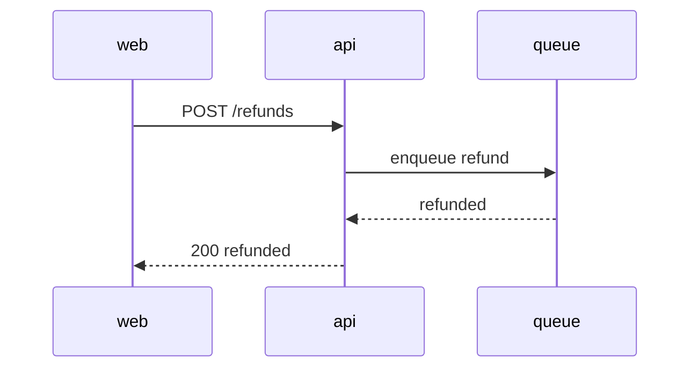

# Review page components

Every component the review page renders, from the plain Markdown an agent writes. Use this page to check how each one looks after a shell change. Select any text to try a comment.

## S1 Headings and ids

A heading or table row whose text starts with an id such as `S1` or `D3` is a block. Comments on it, or on text inside it, are labelled with that id. Hover a heading to see its comment icon.

## D Decisions table

| # | Decision | Why |
|---|---|---|
| D1 | Refunds go through the existing payments queue | One retry policy, one dead-letter queue |
| D2 | Partial refunds are out of scope | Product ruling; tracked as ISSUE-124 |

## Code

Write a fence with a language and you get highlighted code. A fence without one stays plain.

```python
def refund(payment_id: str, amount: int) -> Refund:
    payment = Payment.objects.get(id=payment_id)
    if amount > payment.captured:
        raise RefundTooLarge(payment_id, amount)
    return queue.enqueue("refund", payment_id=payment_id, amount=amount)
```

```diff
- retry_limit = 3
+ retry_limit = 5
```

```json
{ "payment_id": "pay_123", "amount": 500, "reason": "duplicate" }
```

```
plain text, no language
```

## Diagram

Click it to open full screen, scroll to zoom, drag to pan.



## Callouts

> [!NOTE]
> Context the reader needs before the next section.

> [!TIP]
> A shortcut, or the sibling to copy.

> [!IMPORTANT]
> A decision the reviewer must confirm.

> [!WARNING]
> A risk with a mitigation.

> [!CAUTION]
> Something that breaks production if it goes wrong.

> An ordinary quote stays a quote.

## Lists and inline

- `inline code`, **bold**, *italic*, [a link](https://example.com)
- A nested list:
  1. first
  2. second
